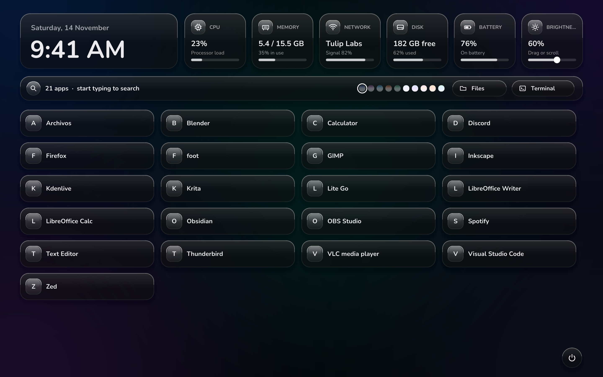
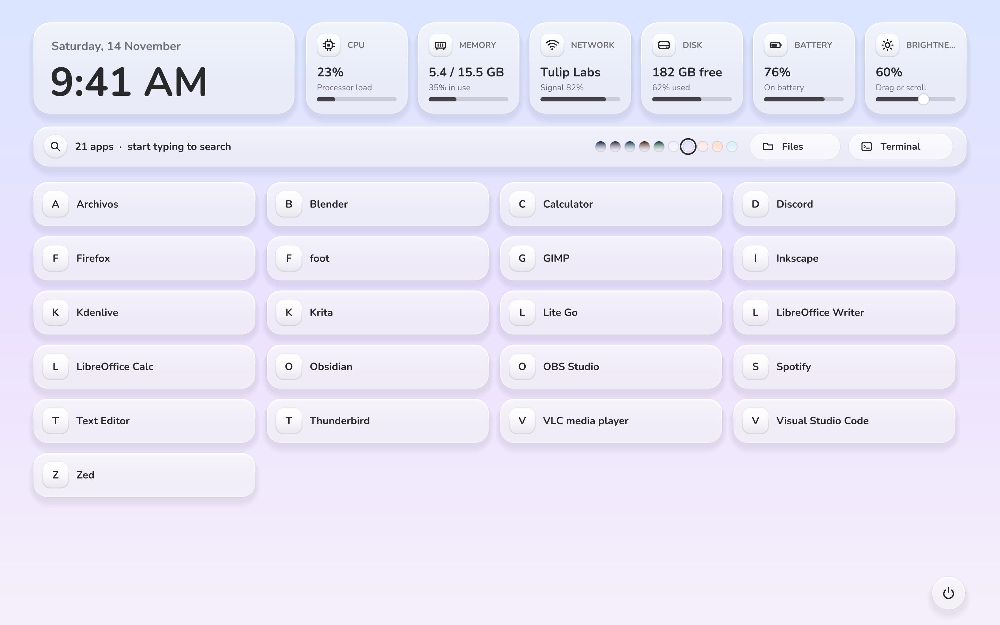
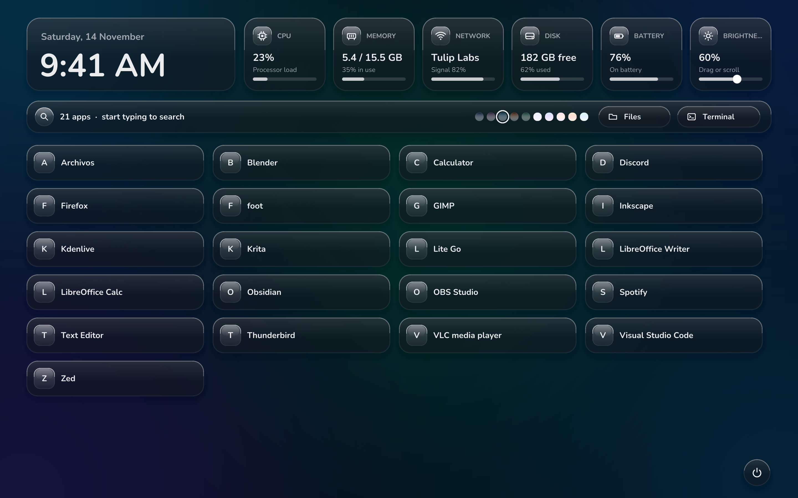
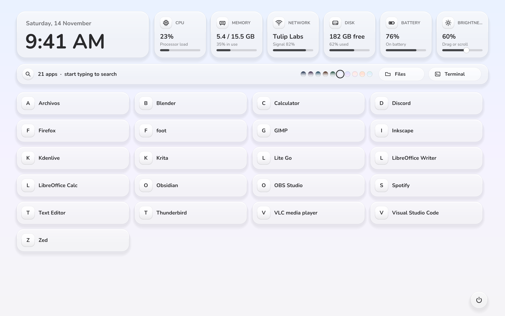
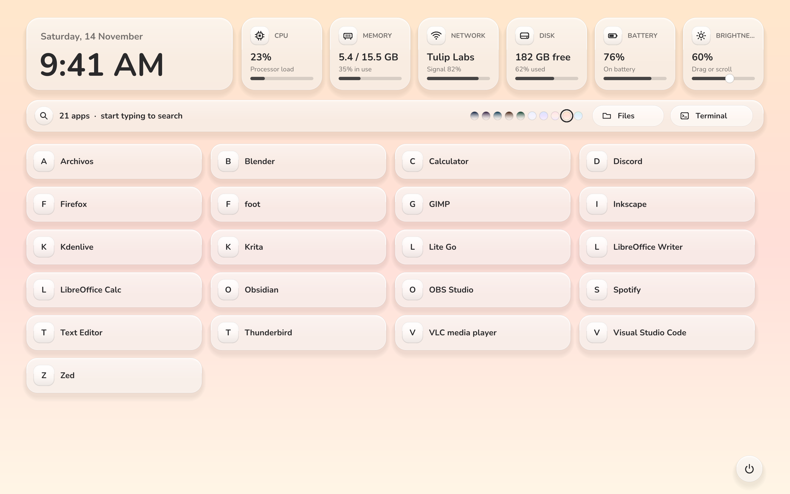

<div align="center">

# Ember

**A calm, full-screen home for your desktop.**
A dashboard and your apps on one screen of clear, colorless liquid glass, in the house style of Iris.

Windows 3.1 · Linux 1.0 on [niri](https://github.com/YaLTeR/niri) · GPL-3.0



</div>

## What it is

Ember replaces the desktop you sign in to with one screen:

- **Dashboard.** The date and time, then cards for processor, memory, network, disk and battery, each with a usage bar, and a **brightness** card: drag its slider or scroll over it.
- **Apps.** Every installed app as a tile. Start typing to search, press Enter to open the top result, or move with the arrow keys.
- **Hide apps.** Right-click an app to hide it. Type `hidden` to see hidden apps; right-click one to bring it back.
- **Wi-Fi in a terminal.** Click the network card: a terminal opens with the networks nearby and a short guide to nmcli.
- **Themes.** Ten glass palettes in the spirit of Apple's Liquid Glass. Dark: Liquid (the default: black, clear glass and glossy liquid icons), Graphite, Deep Sea, Ember and Aurora. Light: Daylight, Mist, Rose, Sunrise and Mint. Click a dot in the search bar to switch; Ember keeps your choice, and niri's colors follow it.
- **Power panel.** Sleep, restart and shut down.
- **No top bar.** Ember's dashboard has the clock, battery and network, so Ember hides the bar niri starts (Waybar) the first time it runs. `ember --show-bar` brings it back; `ember --hide-bar` hides it.

| | |
|---|---|
|  |  |
|  |  |
|  |  |

## Ember for Linux

Ember for Linux is written in Go with [Gio](https://gioui.org) and runs on the **niri** Wayland compositor. niri does all the window management (tiling, workspaces, moving and resizing windows), and Ember is the screen you come back to. Ember does not change niri; it uses niri's own settings file and its IPC socket.

How the pieces fit together:

1. You sign in and choose the **niri** session. niri starts Ember (`spawn-at-startup "ember"`).
2. A window rule tells niri to show Ember full screen with no border.
3. **Super+D** runs `ember --toggle`, which shows or hides Ember. Only one Ember runs; the toggle talks to it over a small socket in your runtime folder.
4. When you open an app, Ember asks niri to start it, so the app belongs to niri, not to Ember. Then Ember hides itself.
5. Ember talks to niri over its IPC socket (`$NIRI_SOCKET`), for instance to bring its own window to the front.
6. niri follows Ember's theme. When you pick a theme, Ember writes `ember-theme.kdl` (the backdrop between windows, a glass focus ring, shadows, the overview, and rounded, slightly see-through windows that niri 26.04 and newer also blur behind) and niri reloads it by itself, so the whole desktop changes together. Dark themes also switch your apps to dark mode and light themes to light mode (GNOME's `color-scheme` setting, which GTK, libadwaita and the desktop portal follow).
7. When Ember hides, it quits: it uses **no memory at all** while you are in your apps, and Super+D starts it again in a moment. (While it is on screen, most of what it uses is the graphics driver every window shares, plus the screen-sized picture itself.)

The cards read `/proc` and `/sys` directly. If NetworkManager (`nmcli`) or `iwgetid` is installed, the network card shows the Wi-Fi name. Settings are kept in `~/.config/ember/settings.json`.

### Install

Ember needs **niri 25.11 or newer** (Fedora: `sudo dnf install niri`; other distributions: see [niri's install page](https://niri-wm.github.io/niri/Getting-Started.html)). Install Ember any of these ways, then sign in to the niri session and run `ember` once from a terminal: Ember adds itself to niri's settings (with a backup of `config.kdl`), and from then on it starts when you sign in and **Super+D** shows or hides it.

**Fedora** (and openSUSE with `zypper addrepo`)

```sh
sudo dnf config-manager addrepo --from-repofile=https://tulip-labs.github.io/Ember/ember-shell.repo
sudo dnf install ember-shell
```

**Debian, Ubuntu**

```sh
curl -fsSL https://tulip-labs.github.io/Ember/ember-shell.gpg | sudo tee /usr/share/keyrings/ember-shell.gpg >/dev/null
echo "deb [signed-by=/usr/share/keyrings/ember-shell.gpg] https://tulip-labs.github.io/Ember/deb stable main" | sudo tee /etc/apt/sources.list.d/ember-shell.list
sudo apt update && sudo apt install ember-shell
```

**Arch**: download the `PKGBUILD` from the latest [release](../../releases/latest) into an empty folder and run `makepkg -si`.

**Nix**: `nix profile install github:Tulip-Labs/Ember`.

**Any distribution, no root**: download `Ember-linux-x86_64.tar.gz` from the [releases](../../releases/latest), unpack it and run `./install.sh`. It installs `ember` to `~/.local/bin` and adds Ember to niri. `./install.sh --remove` takes it all out again.

The `.deb` and `.rpm` are also attached to every release. The repository pages with these commands are at [tulip-labs.github.io/Ember](https://tulip-labs.github.io/Ember/).

**niri settings by hand.** `ember --setup-niri` adds Ember to niri's settings and `ember --remove-niri` takes it out. Ember's part lives in `~/.config/niri/ember.kdl` (keys, start at sign-in, the full-screen rule) and `ember-theme.kdl` (colors); `config.kdl` only gets the line `include "ember.kdl"`.

**Updates.** Ember checks the latest GitHub release every few hours and checks each download against the release's `SHA256SUMS`. A home-folder copy installs the new version by itself and offers **Restart** in the footer; a `.deb` or `.rpm` copy offers **Install** (your password is asked once). To turn it off, set `"autoUpdate": false` in `~/.config/ember/settings.json`. Copies from Nix, the AUR or rpm-ostree update the way those tools do. A Flatpak is not offered: Ember starts your apps and talks to niri, which a Flatpak sandbox does not allow.

### Fedora Atomic (Silverblue, Kinoite and others)

1. **Layer niri and Ember onto the system** (once, then restart):
   ```sh
   sudo curl -fsSLo /etc/yum.repos.d/ember-shell.repo https://tulip-labs.github.io/Ember/ember-shell.repo
   rpm-ostree install niri ember-shell
   systemctl reboot
   ```
   If your Fedora has no `niri` package, add its COPR first: `sudo curl -fsSLo /etc/yum.repos.d/niri.repo https://copr.fedorainfracloud.org/coprs/yalter/niri/repo/fedora-$(rpm -E %fedora)/yalter-niri-fedora-$(rpm -E %fedora).repo`.
2. Sign in to niri and run `ember` once. Updates then come with `rpm-ostree upgrade`.

Or, without layering Ember: use the `.tar.gz` (it installs into your home folder, which is writable on Atomic, and updates itself).

**Building from source**: `linux/build.sh install` (inside a toolbox on Atomic). It needs Go 1.24 or newer and Gio's development files; the commands for each distribution are at the top of the script.

### Keys

| Key | Action |
|---|---|
| Super+D | Show or hide Ember |
| Type | Search |
| Enter | Open the top result, or the selected app |
| Arrow keys, Tab | Select an app |
| Page Up / Page Down | Scroll |
| Esc | Clear the search; press again to hide Ember |

To use another key, edit `binds` in `~/.config/niri/ember.kdl`.

## Ember for Windows

Ember 3.1 for Windows is a Win32 program in C that replaces Explorer as your shell. Its source, installer scripts and notes are in [`windows/`](windows). Run `windows/build.sh` with mingw-w64 to build `Ember.exe`, then read `windows/README.txt` before installing.

## Repository

```
linux/     Ember for Linux (Go + Gio)
  cmd/ember   the program: resident process, toggle socket, window
  shell/      the screen: dashboard, app grid, power panel
  niri/       niri IPC client
  apps/       .desktop entries: scan, search, launch
  sysinfo/    processor, memory, network, disk and battery from /proc and /sys
  update/     updates from the GitHub releases
  ui, giox, raster   the drawing toolkit shared with Iris (formerly Lite Go)
  niri/ember.kdl     niri settings for Ember
  build.sh           builds the program, the .tar.gz, the .deb and the .rpm
  packaging/         install.sh for the .tar.gz
packaging/ the apt and dnf repositories, the AUR recipe, release notes
flake.nix  the Nix package
windows/   Ember 3.1 for Windows (C, Win32)
docs/      screenshots, drawn by the tests
```

The tests draw every screen in software, so they run without a display:

```sh
cd linux && go test ./...
EMBER_SHOTS=../docs go test ./shell   # redraws the screenshots
```

## License

GPL-3.0. See [LICENSE](LICENSE). Ember embeds the Nunito font (SIL Open Font License 1.1) and uses Gio (MIT or Unlicense). niri is a separate program, also GPL-3.0, and Ember does not include any of its code.

Made by Tulip Labs.
