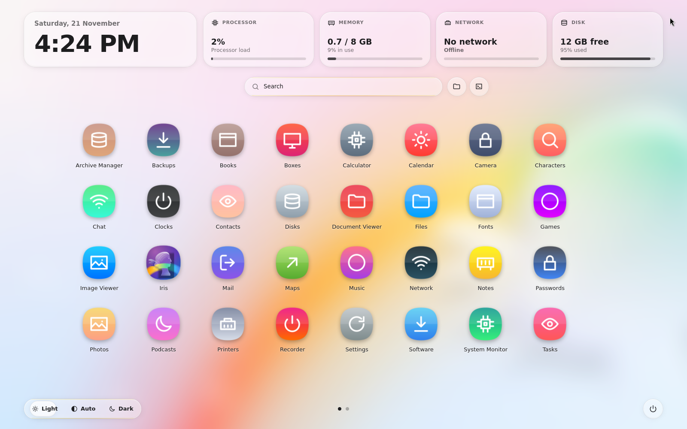
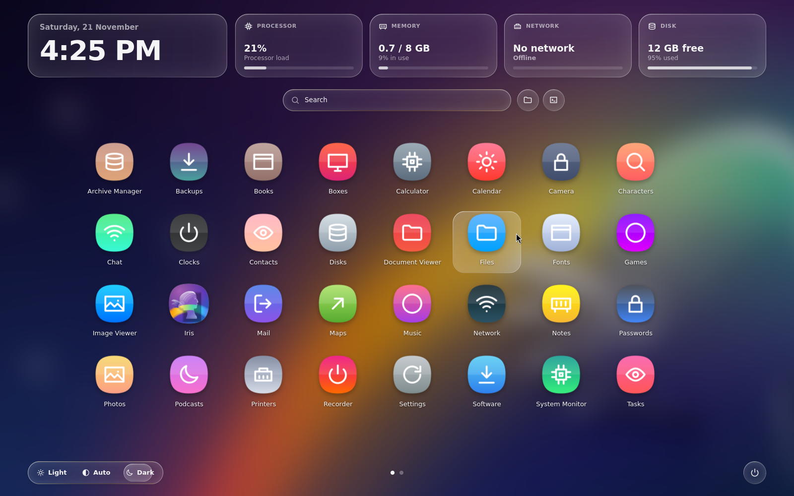
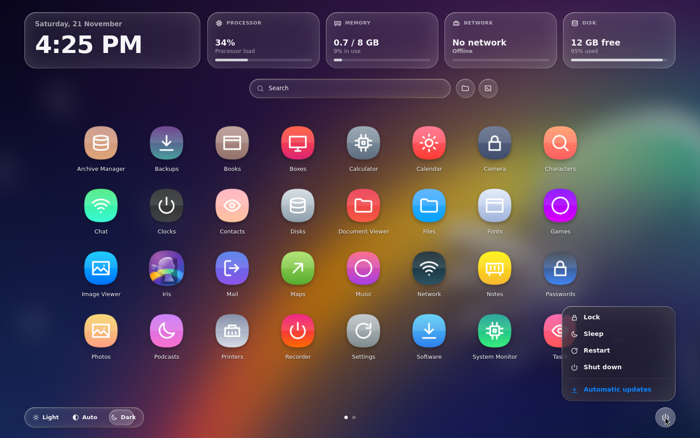
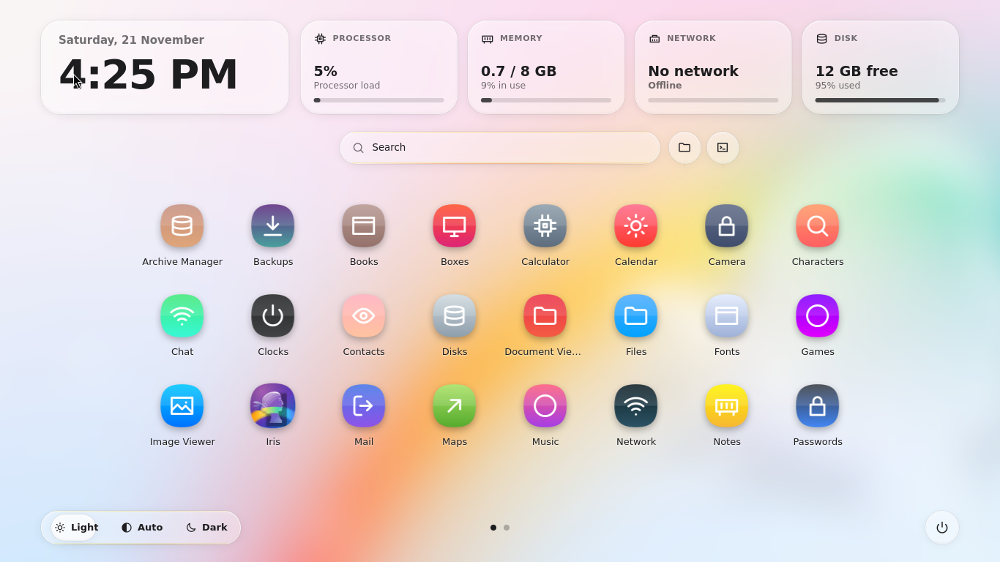

<div align="center">

# Ember

**A calm, full-screen home for your desktop.**
A dashboard and your apps on clear liquid glass, over a wallpaper of Iris, goddess of the rainbow: light by day, dark by night.

Linux 2.0 on [niri](https://github.com/YaLTeR/niri) · Windows 3.1 · GPL-3.0



</div>

## What it is

Ember replaces the desktop you sign in to with one screen, in the same Liquid Glass as the [Iris](https://github.com/Tulip-Labs/Iris-Browser) browser:

- **Apps, as on a Mac.** Every installed app with its own icon and its name under it, in pages you turn with the wheel, the arrow keys or the dots at the bottom. Start typing to search; Enter opens the first match.
- **Dashboard.** The date and time, then cards for processor, memory, network, disk and battery, and a **brightness** slider. Click the network card for the Wi-Fi networks nearby and a short guide to nmcli.
- **Light, Dark or Auto.** As on a Mac: pick one at the bottom left. Auto is light from 7:00 and dark from 19:00. Everything follows: Ember's glass, niri's windows, your apps (light or dark mode) and the wallpaper.
- **Iris on your desktop.** A new wallpaper, drawn for Ember: Iris, goddess of the rainbow, in liquid glass, in a light and a dark version. Ember blurs it behind its own screen as it comes up.
- **niri dressed to match.** Rounded windows with soft shadows and gaps, a focus ring in Iris's colours, the wallpaper kept still in the overview, and (niri 26.04 and newer) blur behind translucent windows.
- **Hide apps.** Right-click an app to hide it. The eye at the bottom (or typing `hidden`) shows the hidden apps; right-click one to bring it back.
- **Power.** Lock, sleep, turn off screens, sign out, restart and shut down, plus the top bar, the wallpaper and updates.

| | |
|---|---|
|  |  |
|  |  |
|  |  |

## Ember for Linux

Ember 2 for Linux is written in **Swift** with **GTK 4 and libadwaita**, and draws its glass with GTK's own render nodes (no shaders), the same code as Iris: what lies behind the glass stays sharp and bends at the rim, with a touch of colour split, a rim of light, and springs for every move. It runs on the **niri** Wayland compositor. niri does all the window management, and Ember is the screen you come back to. Ember does not change niri; it uses niri's own settings file and its IPC socket.

How the pieces fit together:

1. You sign in and choose the **niri** session. niri starts Ember (`spawn-at-startup "ember"`) and its wallpaper (`ember --wallpaper`, which keeps swaybg showing Iris and switches her with the appearance).
2. A window rule tells niri to show Ember full screen with no border.
3. **Super+D** runs `ember --toggle`, which shows or hides Ember. Only one Ember runs; the toggle talks to it over a small socket in your runtime folder.
4. When you open an app, Ember asks niri to start it, so the app belongs to niri, not to Ember. Then Ember hides itself.
5. niri follows Ember's appearance: Ember writes `ember-theme.kdl` and niri reloads it by itself. Your apps follow too (GNOME's `color-scheme` setting, which GTK, libadwaita, browsers and Electron apps follow).
6. When Ember hides, it quits: it uses **no memory** while you are in your apps, and Super+D starts it again in a moment.

The cards read `/proc` and `/sys` directly. If NetworkManager (`nmcli`) or `iwgetid` is installed, the network card shows the Wi-Fi name. Settings are kept in `~/.config/ember/settings.json` (`appearance`, `dayStarts` and `nightStarts` for Auto, `wallpaper`, `hidden`, `autoUpdate`).

### Install

Ember needs **niri 25.11 or newer**, **GTK 4.14+** and **libadwaita 1.5+** (Fedora 40+, Ubuntu 24.04+, Debian 13+, Arch, openSUSE Tumbleweed), and **swaybg** for the wallpaper. Install Ember any of these ways, then sign in to the niri session and run `ember` once from a terminal: Ember adds itself to niri's settings (with a backup of `config.kdl`), and from then on it starts when you sign in and **Super+D** shows or hides it.

**Fedora** (and openSUSE with `zypper addrepo`)

```sh
sudo dnf config-manager addrepo --from-repofile=https://tulip-labs.github.io/Ember/ember-shell.repo
sudo dnf install ember-shell swaybg
```

**Debian, Ubuntu**

```sh
curl -fsSL https://tulip-labs.github.io/Ember/ember-shell.gpg | sudo tee /usr/share/keyrings/ember-shell.gpg >/dev/null
echo "deb [signed-by=/usr/share/keyrings/ember-shell.gpg] https://tulip-labs.github.io/Ember/deb stable main" | sudo tee /etc/apt/sources.list.d/ember-shell.list
sudo apt update && sudo apt install ember-shell swaybg
```

**Arch**: download the `PKGBUILD` from the latest [release](../../releases/latest) into an empty folder and run `makepkg -si`.

**Nix**: `nix profile install github:Tulip-Labs/Ember` (it builds from source and needs a nixpkgs with Swift 6).

**Any distribution, no root**: download `Ember-linux-x86_64.tar.gz` from the [releases](../../releases/latest), unpack it and run `./install.sh`. It installs `ember` to `~/.local/bin` and adds Ember to niri. `./install.sh --remove` takes it all out again.

**niri settings by hand.** `ember --setup-niri` adds Ember to niri's settings and `ember --remove-niri` takes it out. Ember's part lives in `~/.config/niri/ember.kdl` (keys, start at sign-in, the wallpaper, the full-screen rule) and `ember-theme.kdl` (the look); `config.kdl` only gets the line `include "ember.kdl"`. If `config.kdl` starts another wallpaper (swaybg, swww, hyprpaper and others), Ember comments that line out, marked as Ember's; turning the Iris wallpaper off (Power, then Iris wallpaper) or `--remove-niri` puts it back.

**From the command line.** `ember --light`, `--dark` and `--auto` pick the appearance; `ember --hide-bar` and `--show-bar` hide or show Waybar; `ember --power` opens the power panel.

**Updates.** Ember checks the latest GitHub release once a day and checks each download against the release's `SHA256SUMS`. A home-folder copy installs the new version by itself and offers **Restart**; a `.deb` or `.rpm` copy offers **Install** (your password is asked once). Power, then Automatic updates, turns this off. Copies from Nix, the AUR or rpm-ostree update the way those tools do. A Flatpak is not offered: Ember starts your apps and talks to niri, which a Flatpak sandbox does not allow.

**Updating from Ember 1.** Ember 1 updates itself to Ember 2 as usual. Ember 2 rewrites `ember.kdl` and `ember-theme.kdl` the first time it starts; Ember 1's ten themes become Light (the light ones) or Auto.

### Fedora Atomic (Silverblue, Kinoite and others)

1. **Layer niri and Ember onto the system** (once, then restart):
   ```sh
   sudo curl -fsSLo /etc/yum.repos.d/ember-shell.repo https://tulip-labs.github.io/Ember/ember-shell.repo
   rpm-ostree install niri ember-shell swaybg
   systemctl reboot
   ```
   If your Fedora has no `niri` package, add its COPR first: `sudo curl -fsSLo /etc/yum.repos.d/niri.repo https://copr.fedorainfracloud.org/coprs/yalter/niri/repo/fedora-$(rpm -E %fedora)/yalter-niri-fedora-$(rpm -E %fedora).repo`.
2. Sign in to niri and run `ember` once. Updates then come with `rpm-ostree upgrade`.

Or, without layering Ember: use the `.tar.gz` (it installs into your home folder, which is writable on Atomic, and updates itself).

**Building from source**: `linux/build.sh install` (inside a toolbox on Atomic). It needs Swift 6.0 or newer ([swift.org/install](https://www.swift.org/install/)) and the GTK 4 and libadwaita development files; the commands for each distribution are at the top of the script.

### Keys

| Key | Action |
|---|---|
| Super+D | Show or hide Ember |
| Type | Search |
| Enter | Open the first match, or the selected app |
| Arrow keys, Tab | Select an app |
| Page Up / Page Down, the wheel | Turn the page |
| Esc | Close a panel, clear the search; press again to hide Ember |

To use another key, edit `binds` in `~/.config/niri/ember.kdl`.

## Ember for Windows

Ember 3.1 for Windows is a Win32 program in C that replaces Explorer as your shell. Its source, installer scripts and notes are in [`windows/`](windows). Run `windows/build.sh` with mingw-w64 to build `Ember.exe`, then read `windows/README.txt` before installing.

## Repository

```
linux/     Ember for Linux (Swift, GTK 4, libadwaita)
  Sources/Ember/
    Main.swift        the program: options, the toggle socket, first start
    Shell.swift       the window: the blurred wallpaper, layout, keys, appearance
    Grid.swift        the apps in pages: icons, names, search, hiding
    Dashboard.swift   the clock and the cards
    Bar.swift         search, the bottom bar, power panel, menus, notes
    Stage, Glass, Motion   Liquid Glass and springs (shared with Iris)
    Theme.swift       Light and Dark: Ember's glass, niri's look, apps' mode
    Wallpaper.swift   the Iris wallpapers and `ember --wallpaper`
    Niri.swift        niri's IPC socket and settings (ember.kdl)
    Apps, Sys, Run, Store, Updates, UI   apps, readings, programs, settings, updates, glyphs
  Sources/CData/      the wallpapers, built into the program
  build.sh            builds the program, the .tar.gz, the .deb and the .rpm
  packaging/          install.sh for the .tar.gz
assets/wallpapers/  the wallpapers' drawing (SVG) and gen.js, which makes it
packaging/ the apt and dnf repositories, the AUR recipe, release notes
flake.nix  the Nix package
windows/   Ember 3.1 for Windows (C, Win32)
docs/      screenshots
```

The tests need no display:

```sh
cd linux && swift test
```

## License

GPL-3.0. See [LICENSE](LICENSE). The Iris wallpapers are original drawings made for Ember, under the same license. Ember uses GTK 4 and libadwaita (LGPL-2.1 or later). niri and swaybg are separate programs, and Ember does not include any of their code.

Made by Tulip Labs.
