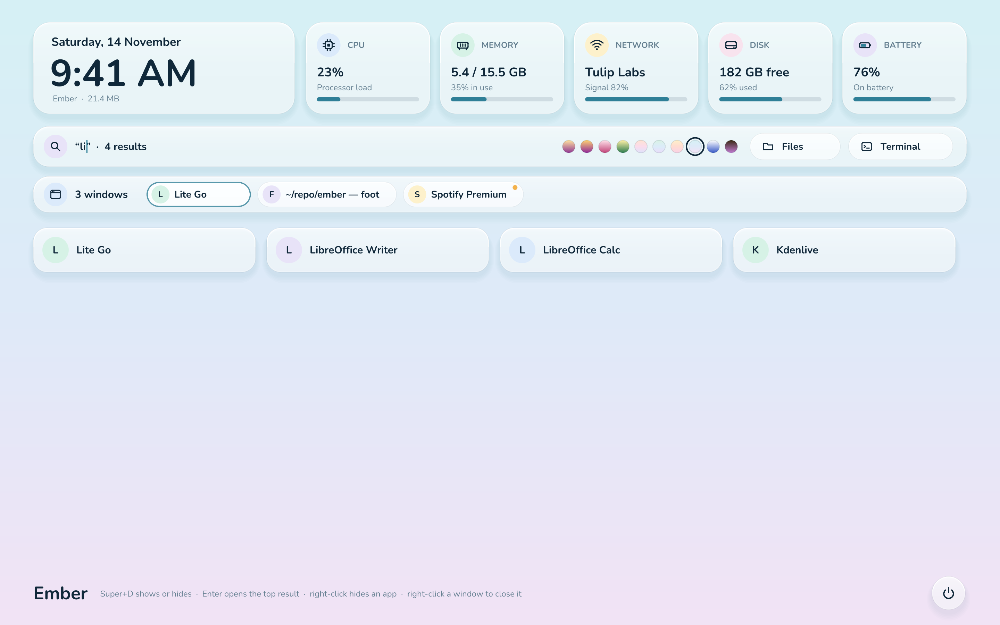
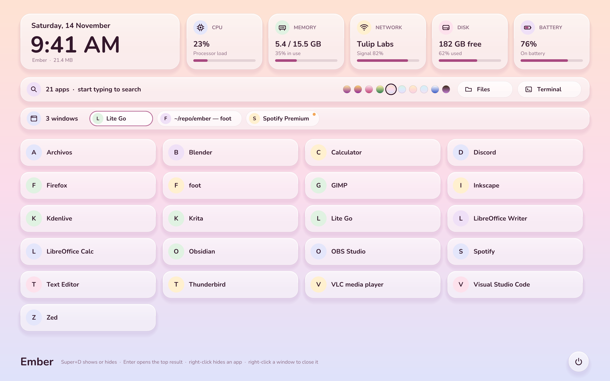
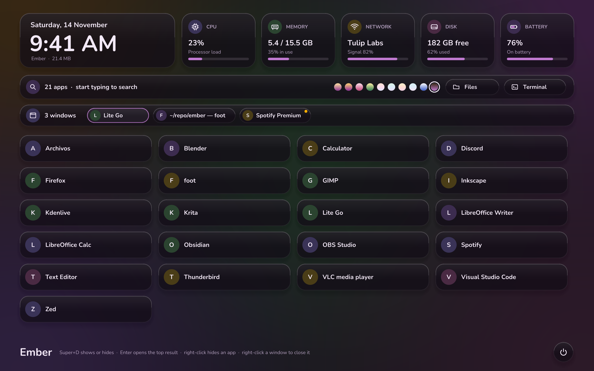

<div align="center">

# Ember

**A calm, full-screen home for your desktop.**
A dashboard, your apps and your open windows on one pastel screen, in the house style of Lite Go.

Windows 3.1 · Linux 1.0 on [niri](https://github.com/YaLTeR/niri) · GPL-3.0


</div>

## What it is

Ember replaces the desktop you sign in to with one screen:

- **Dashboard.** The date and time, then cards for processor, memory, network, disk and battery, each with a usage bar.
- **Apps.** Every installed app as a tile. Start typing to search, press Enter to open the top result, or move with the arrow keys.
- **Hide apps.** Right-click an app to hide it. Type `hidden` to see hidden apps; right-click one to bring it back.
- **Open windows** (Linux). Every window niri manages, in a row. Click one to go to it, or right-click it to close it.
- **Themes.** The palettes of Lite Go: Lagoon (the default), Crocus, Tulip, Sakura, Meadow, Peach Sky, Mint Lilac, Sorbet, Classic and Night. Click a dot in the search bar to switch; Ember keeps your choice.
- **Power panel.** Lock, sleep, sign out, restart, shut down, turn the screens off, exit Ember.

| | |
|---|---|
|  |  |
|  |  |

## Ember for Linux

Ember for Linux is written in Go with [Gio](https://gioui.org) and runs on the **niri** Wayland compositor. niri does all the window management (tiling, workspaces, moving and resizing windows), and Ember is the screen you come back to. Ember does not change niri; it uses niri's own settings file and its IPC socket.

How the pieces fit together:

1. You sign in and choose the **niri** session. niri starts Ember (`spawn-at-startup "ember"`).
2. A window rule tells niri to show Ember full screen with no border.
3. **Super+D** runs `ember --toggle`, which shows or hides Ember. Only one Ember runs; the toggle talks to it over a small socket in your runtime folder.
4. When you open an app, Ember asks niri to start it, so the app belongs to niri, not to Ember. Then Ember hides itself.
5. The windows row comes from niri's IPC (`$NIRI_SOCKET`): Ember asks which windows are open and tells niri which one to focus or close.
6. While Ember is hidden, its window is closed and its memory is given back. The app list and your settings stay in the background process.

The cards read `/proc` and `/sys` directly. If NetworkManager (`nmcli`) or `iwgetid` is installed, the network card shows the Wi-Fi name. Settings are kept in `~/.config/ember/settings.json`.

### Install

Download `ember-linux-x86_64.tar.gz` from the [releases](../../releases). Unpack it and run:

```sh
./install.sh
```

The script installs `ember` to `~/.local/bin`, copies `ember.kdl` next to your niri config, and adds `include "ember.kdl"` at the end of `~/.config/niri/config.kdl`. It saves a backup as `config.kdl.before-ember` first. This needs niri 25.11 or newer. Nothing is installed system-wide, so no root is needed. `./install.sh --remove` undoes all of it.

To build from source instead, run `./install.sh` inside `linux/`. It needs Go 1.24 or newer and the Gio development files; the commands for each distribution are at the top of the script.

### Fedora Atomic (Silverblue, Kinoite and others)

Ember works on immutable Fedora without changes, because it installs only into your home folder:

1. **Layer niri onto the system** (once, then restart). Add the niri COPR repository and install the package:
   ```sh
   sudo curl -o /etc/yum.repos.d/niri.repo https://copr.fedorainfracloud.org/coprs/yalter/niri/repo/fedora-$(rpm -E %fedora)/yalter-niri-fedora-$(rpm -E %fedora).repo
   rpm-ostree install niri
   systemctl reboot
   ```
   You can also use an image that already includes niri, such as one from the Universal Blue / wayblue family.
2. **Install Ember from the release.** `install.sh` writes only to `~/.local/bin` and `~/.config/niri`, which are writable on Atomic.
3. **Building from source** works best inside a toolbox (`toolbox create`, then install Go and the development files there with `dnf`). The `ember` binary you build there runs on the host, which already has the Wayland and graphics libraries it needs.

### Keys

| Key | Action |
|---|---|
| Super+D | Show or hide Ember |
| Type | Search |
| Enter | Open the top result, or the selected app |
| Arrow keys, Tab | Select an app |
| Page Up / Page Down | Scroll |
| Esc | Clear the search; press again to hide Ember |

To use another key, edit `binds` in `~/.config/niri/ember.kdl`.

## Ember for Windows

Ember 3.1 for Windows is a Win32 program in C that replaces Explorer as your shell. Its source, installer scripts and notes are in [`windows/`](windows). Run `windows/build.sh` with mingw-w64 to build `Ember.exe`, then read `windows/README.txt` before installing.

## Repository

```
linux/     Ember for Linux (Go + Gio)
  cmd/ember   the program: resident process, toggle socket, window
  shell/      the screen: dashboard, windows row, app grid, power panel
  niri/       niri IPC client
  apps/       .desktop entries: scan, search, launch
  sysinfo/    processor, memory, network, disk and battery from /proc and /sys
  ui, giox, raster   the drawing toolkit shared with Lite Go
  dist/ember.kdl     niri settings for Ember
windows/   Ember 3.1 for Windows (C, Win32)
docs/      screenshots, drawn by the tests
```

The tests draw every screen in software, so they run without a display:

```sh
cd linux && go test ./...
EMBER_SHOTS=../docs go test ./shell   # redraws the screenshots
```

## License

GPL-3.0. See [LICENSE](LICENSE). Ember embeds the Nunito font (SIL Open Font License 1.1) and uses Gio (MIT or Unlicense). niri is a separate program, also GPL-3.0, and Ember does not include any of its code.

Made by Tulip Labs.
